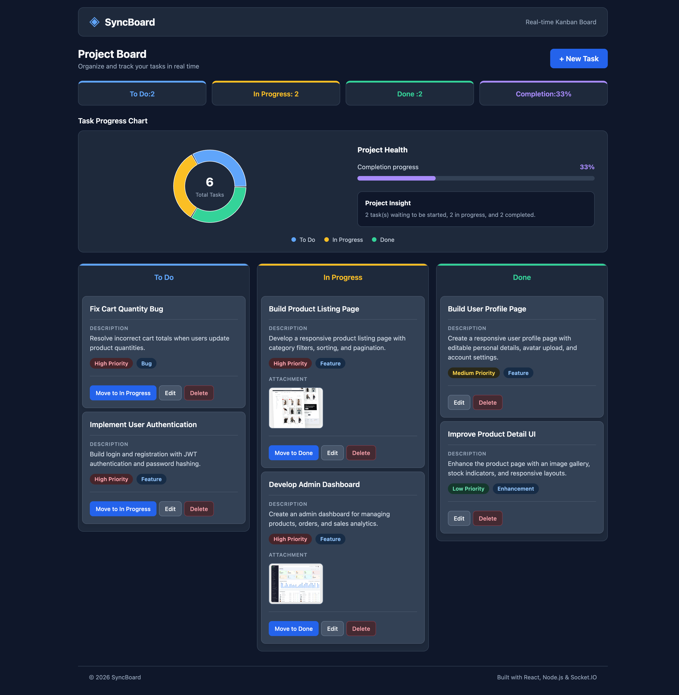
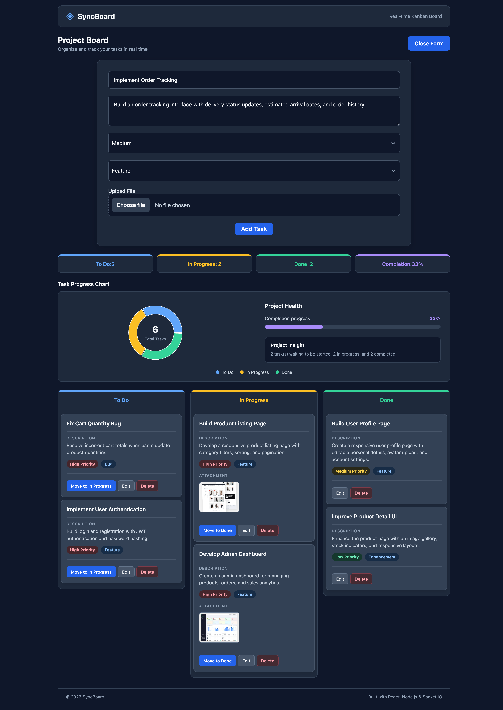

# SyncBoard — Real-Time Kanban Board

SyncBoard is a responsive, real-time task management application built with React, Node.js, Express, and Socket.IO. It enables users to organize tasks across Kanban columns, track project progress, and collaborate through real-time task synchronization.

## 🚀 Live Demo

[View SyncBoard](https://realtime-kanban-board-five.vercel.app)

## ✨ Features

- **Task Management:** Create, edit, delete, and move tasks between To Do, In Progress, and Done.
- **Drag-and-Drop:** Move tasks between Kanban columns using React DnD.
- **Real-Time Synchronization:** Task changes are synchronized across connected clients using Socket.IO.
- **Task Organization:** Assign priorities and categories to tasks.
- **File Attachments:** Attach images and PDFs, with image previews and file validation.
- **Project Dashboard:** Visualize task distribution, completion percentage, and project health using Recharts.
- **Responsive Interface:** Layouts optimized for desktop, tablet, and mobile screens.
- **Automated Testing:** Unit, integration, and end-to-end tests using Vitest, React Testing Library, and Playwright.

## 📸 Screenshots

### Project Dashboard



### Create a New Task



## 🛠️ Tech Stack

### Frontend

- React
- Vite
- Socket.IO Client
- React DnD
- React Select
- Recharts
- React Icons
- CSS
- Vitest
- React Testing Library
- Playwright

### Backend

- Node.js
- Express
- Socket.IO

## 📁 Project Structure

```text
websocket-kanban-vitest-playwright-2026-main/
├── backend/
│
├── frontend/
│   ├── public/
│   │   └── favicon.svg
│   ├── src/
│   │   ├── components/
│   │   │   ├── Header/
│   │   │   │   ├── Header.jsx
│   │   │   │   └── Header.css
│   │   │   ├── Footer/
│   │   │   │   ├── Footer.jsx
│   │   │   │   └── Footer.css
│   │   │   ├── KanbanBoard/
│   │   │   │   ├── KanbanBoard.jsx
│   │   │   │   └── KanbanBoard.css
│   │   │   ├── TaskCard/
│   │   │   │   ├── TaskCard.jsx
│   │   │   │   └── TaskCard.css
│   │   │   ├── TaskChart/
│   │   │   │   ├── TaskChart.jsx
│   │   │   │   └── TaskChart.css
│   │   │   ├── CustomSelect/
│   │   │   │   ├── CustomSelect.jsx
│   │   │   │   └── CustomSelect.styles.js
│   │   │   └── DropColumn.jsx
│   │   ├── tests/
│   │   │   ├── unit/
│   │   │   │   └── KanbanBoard.test.jsx
│   │   │   ├── integration/
│   │   │   │   └── WebSocketIntegration.test.jsx
│   │   │   └── e2e/
│   │   ├── App.jsx
│   │   ├── index.css
│   │   └── socket.js
│   └── index.html
│
├── screenshots/
│   ├── dashboard.png
│   └── create-task.png
│
└── README.md
```

## ⚙️ Getting Started

### 1. Install Backend Dependencies

```bash
cd backend
npm install
```

### 2. Start Backend Server

```bash
npm run dev
```

Backend runs at `http://localhost:8000`.

### 3. Install Frontend Dependencies

Open another terminal from the project root:

```bash
cd frontend
npm install
```

### 4. Start Frontend

```bash
npm run dev
```

Frontend runs at `http://localhost:3000`.

## 🔄 WebSocket Events

| Event         | Description                                         |
| ------------- | --------------------------------------------------- |
| `task:create` | Creates a new task                                  |
| `task:update` | Updates task details                                |
| `task:move`   | Moves a task between columns                        |
| `task:delete` | Deletes a task                                      |
| `sync:tasks`  | Synchronizes the task list across connected clients |

## 🧪 Testing

### Unit and Integration Tests

```bash
cd frontend
npm test -- --run
```

Tests cover Kanban board rendering, invalid file validation, task creation events, and real-time synchronization.

### End-to-End Tests

Start both backend and frontend servers, then run:

```bash
cd frontend
npm run test:e2e
```

If Playwright browsers are not installed:

```bash
npx playwright install
```

End-to-end scenarios include creating tasks and dragging tasks between columns.

## 📝 Current Limitations

- Tasks are stored in backend memory rather than a database.
- Task data resets when the backend server restarts.
- File uploads use temporary browser object URLs rather than persistent storage.
- Image attachment URLs may not remain available after a refresh or server restart.

## 🔮 Future Improvements

- Persist tasks using MongoDB.
- Store attachments using cloud storage.
- Add user authentication and individual workspaces.
- Implement task filtering and search.
- Add due dates and task assignments.
- Introduce collaborative features such as activity history and notifications.
